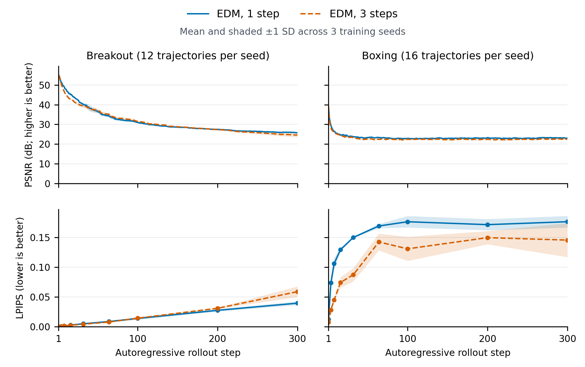
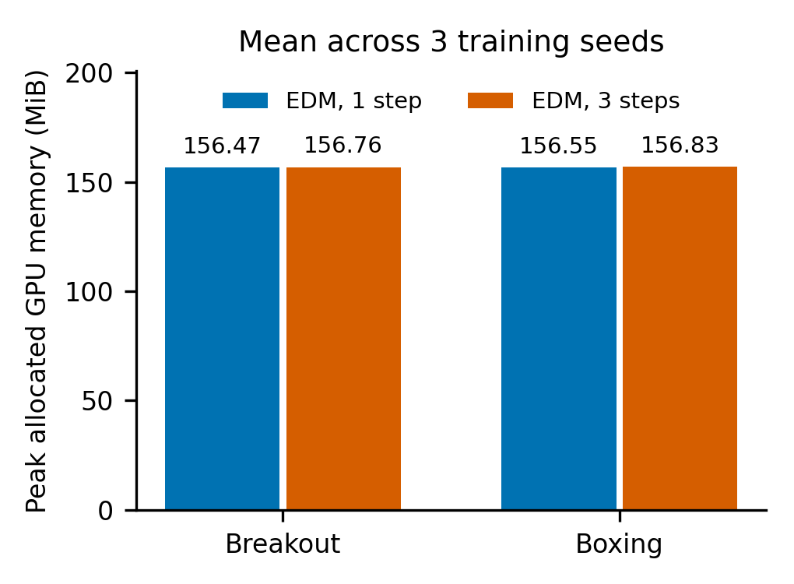

# EDM: three-seed results

Mean over seeds 0, 1 and 2, each trained for 100,000 updates on the same fixed dataset per game.

| Game | Steps | Next PSNR (dB) | Next LPIPS | PSNR at 300 | LPIPS at 300 | Median ms | p95 ms | FPS |
| --- | ---: | ---: | ---: | ---: | ---: | ---: | ---: | ---: |
| Breakout | 1 | 54.27 | 0.000257 | 25.79 | 0.0395 | 6.30 | 6.79 | 157.74 |
| Breakout | 3 | 54.31 | 0.000272 | 24.62 | 0.0589 | 18.58 | 18.80 | 53.72 |
| Boxing | 1 | 36.72 | 0.013944 | 23.07 | 0.1767 | 6.45 | 6.50 | 154.84 |
| Boxing | 3 | 37.20 | 0.007706 | 22.63 | 0.1457 | 18.94 | 19.03 | 52.80 |

Next-frame evaluation uses the same held-out windows across seeds. Rollouts use the same eligible trajectories per game and recorded actions; generated frames become context.
Latency columns average the per-run median and p95; FPS averages 1000 / mean latency per run. Batch-one FP32 includes CPU/GPU transfers, excludes environment/display time.
The rollout bands show sample standard deviation across three seed-level trajectory means. LPIPS is measured at nine marked steps only. These are generator metrics, not gameplay scores. FVD is not measured.

Memory is peak PyTorch-allocated live tensor memory during inference (including warmup), averaged across seeds. It excludes CUDA context and other allocations; it is not total device usage or incremental memory per frame.
